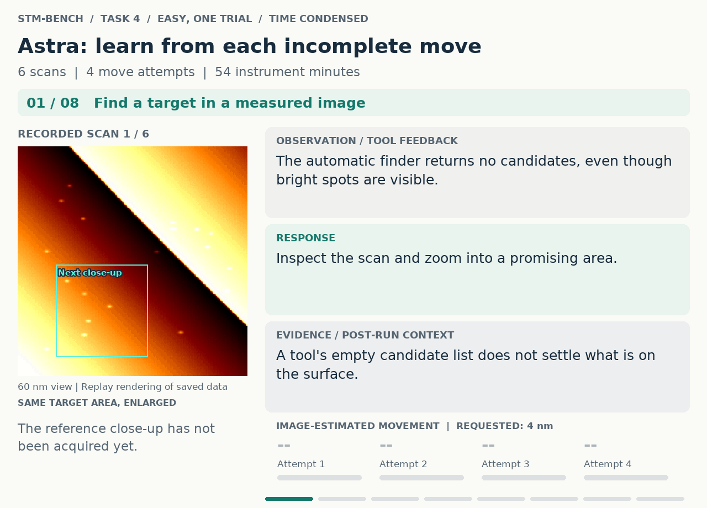

# STM-Bench

[English](README.md) · **中文**

**面向实验智能的扫描隧道显微镜模拟器与评测基准。**

STM-Bench 将扫描探针显微学的经典实验转化为可复现的自主实验能力测试。智能体需要操作显微镜、建立有效的测量条件、定位纳米尺度结构、采集图像与谱线、操纵原子，并以记录在案的实验证据支持科学结论。

> AI 能否从陌生的仪器状态出发，完成一项实验，并获得经验证的科学结果？

项目将具有状态演化的物理模拟器、五个科学主题下的六项论文启发场景、独立的仪器接口与检查采集证据的判分器整合在一起。支持 MCP 的智能体可通过 `stmbench.instrument` 开展完整实验。测量参考协议、随机种子生成的环境变化与动作重放，使任务本身及其评估过程都可供检验。

**当前研究版本：**独立 MCP 实验回合、可复现的虚拟仪器时间、明确采集证据与坐标参照的版本化判分规则、dI/dV 成像，以及量子围栏谱学、单原子定位和 qPlus 力谱的多种子参考结果。参见[测量参考结果](#测量参考结果)与[快速开始](#快速开始)。

## 为什么 STM 适合检验实验智能

扫描隧道显微镜在原子尺度上连接了感知、物理干预与科学推断。隧穿电流近似指数依赖于针尖—样品间距；恒流成像通过反馈将隧穿结的响应转换为高度信号。样品的电子结构和针尖状态共同决定观测结果。[Tersoff–Hamann 理论](https://doi.org/10.1103/PhysRevB.31.805)为理解这一关系提供了基础。

STM 图像是实验过程产生的观测。它的解释取决于偏压、电流、扫描几何、反馈与采集历史。一个清晰特征的位置变化，可能来自原子移动、样品漂移，也可能来自针尖改变。理解一条谱线的采集位置、稳定条件与参考测量，才能赋予它明确的科学意义。因此，成功的实验操作需要选择下一项能够消除关键不确定性的观测。

| 实验挑战 | 智能体需要做到什么 |
|---|---|
| **针尖—样品结只能被部分观测** | 从测量中推断针尖状态，必要时修针，并确认其恢复。 |
| **坐标关系随时间变化** | 估计漂移与蠕变，重访目标，并关联不同时间、不同尺度下的测量。 |
| **测量参数彼此耦合** | 权衡视场、空间分辨率、扫描速度、信号质量与仪器时间。 |
| **操作会改变样品** | 找到有效的操纵条件，跟踪原子响应，保护邻近结构，并验证最终状态。 |
| **科学结论必须可量化** | 将几何结构、谱线与物理模型联系起来，给出具有单位、容差和采集证据的结果。 |

这些要求使 STM 成为研究主动感知、不确定性下的规划与实验控制的紧凑而丰富的科学场景。表面重构、电子驻波、量子限域与原子操纵的经典实验，提供了具体的科学目标和具有物理意义的成功标准。STM-Bench 延续这一实验传统，将完整的测量过程纳入评估。

## 六项实验，五个科学主题

每个场景都提供实验任务、仪器时间预算，以及从判分配置生成的规则卡。不同随机种子改变相关几何结构、材料参数、针尖状态与操纵行为。智能体通过仪器获得观测；评估器保留检验实验结果所需的隐藏状态。

| 场景 | 科学目标 | 要求的结果 |
|---|---|---|
| **P1 · Au(111) 重构** | 参照 [Barth 等](https://doi.org/10.1103/PhysRevB.42.9307)的实验，对人字形重构成像并寻找旋转畴。 | 条纹周期、某处取向，以及两个不同旋转畴的位置与取向。 |
| **P2 · Cu(111) 驻波** | 参照 [Crommie 等](https://doi.org/10.1038/363524a0)的实验，从空间与能量分辨测量恢复表面态色散。 | 带底能量与有效质量，并以散射体附近的谱线或多个能量下的 dI/dV 图作为证据。 |
| **P3 · 量子围栏谱学** | 参照 [Crommie 等](https://doi.org/10.1126/science.262.5131.218)的实验，建立 Fe 原子围栏几何结构与限域电子态之间的联系。 | 围栏半径，以及中心谱中两个不同、按能量递增报告的低能共振。 |
| **P3-repair · 先构筑，再测量** | 修复受损的原子围栏，再测量其电子态。 | 至少 97% 的环占据率、操纵后图像，以及操纵后测得的两个中心共振。 |
| **P4 · 单原子定位** | 将 Cu(111) 上一个孤立 Fe 原子沿 +x 移动 4 nm 至最近晶格位点，同时保持邻近原子不变；改编自 [Eigler 与 Schweizer](https://doi.org/10.1038/344524a0)的实验。 | 验证目标位点占据，给出与复查图像对应的最终位置，并确认邻近原子得到保留。 |
| **P5 · qPlus 力谱** | 采集原子与背景的 Δf(z) 曲线，应用 [Sader–Jarvis 力反演](https://doi.org/10.1063/1.1667267)；科学目标参考 [Huber 等](https://doi.org/10.1126/science.aay3444)的工作。 | 短程力极小值、衰减长度与结合能。 |

这些场景将经典论文的科学目标转化为具有明确模型的模拟实验。P4 采用 Fe/Cu(111)，Eigler–Schweizer 原实验采用 Xe/Ni(110)。P3 的峰判据允许从最低三个真实共振中匹配两个不同的峰，以容纳最低能级在测得谱线上表现为肩峰的情况。P3 当前的峰容差为 ±10 meV，半径容差为 ±0.15 nm。P5 的力极小值、衰减长度与结合能分别采用 15%、8% 和 20% 的相对容差。[场景文件](stmbench/trackB/scenarios/)定义了完整、版本化的实验与判分约定；P3-repair 保留自身规则，其参考协议仍在标定中。

## 从测量到经验证的科学结果

基准的核心原则是：**科学结果必须同时提供任务要求的采集证据。** 一个完整回合将仪器操作、结构化结果报告与模拟样品状态的检验联系起来。

1. **阅读实验任务。** `get_task` 提供目标、判分规则和仪器手册。智能体可以直接查看容差与证据要求。
2. **采集与操作。** 智能体控制偏压、电流、反馈、扫描几何、谱学测量、漂移补偿、修针与针尖移动，接收图像、数值观测和已保存数据的标识。
3. **报告结果及其来源。** `report_result` 指明结果项、数值、单位及所依据的图像或谱线。位置报告还需注明读取坐标的图像。
4. **验证实验。** 判分器检查数值、采集条件、空间覆盖、事件先后顺序与必要的样品状态约束。在回合预算内满足场景中的全部结果项，才构成完整成功。

在 STM 的长度尺度上，图像来源与坐标参照尤为关键。评估器根据对应采集行记录的漂移映射报告坐标。操纵后的复查图必须晚于原子移动；谱线必须在指定位置覆盖所需能量范围。[版本 1 规则](stmbench/trackB/rules.py)将这些要求直接呈现给智能体。

采集检查确认必要的测量确实发生，且所报告的证据满足任务要求；智能体内部如何推导数值不在这一检查范围内。部分结果项明确允许使用材料知识，包括 P1 的周期与 P2 的材料参数，同时仍要求完成相应采集。这样，先验知识与实验证据各自承担的作用都得到明确说明。

### 可复现的仪器时间与动作重放

独立仪器采用**虚拟时钟**。扫描、谱学采集、移动与等待，均按其物理持续时间推进时钟。读取已保存图像或查询状态，既不消耗仪器时间，也不消耗随机数。因此，主机速度与模型响应延迟不会改变两次操作之间的仪器演化。

每个回合记录动作、事件、结果报告、测量哈希值，以及采集的 `.sxm` / `.dat` 文件。`stmbench verify` 根据种子和动作重建回合，再比较测量数据与判分结果。请将代码版本与软件环境一同记录，使可复现性能够在实际采集数据的层面得到检验。

## 物理机制如何影响实验

`stmsim` 将表面、变化的针尖、扫描器、隧穿结、反馈和测量通道建模为彼此耦合的实验系统。仪器设置既影响当前能看见什么，也决定后续操作将产生怎样的结果。

| 子系统 | 模拟的实验行为 |
|---|---|
| **成像与针尖状态** | 恒流形貌；二维针尖半径模糊；锐针、钝针、双针、不稳定针尖和污染针尖；电子噪声；随机针尖变化与修针。 |
| **扫描器与反馈** | 采集中的漂移与蠕变、主动漂移补偿、反馈滞后，以及随扫描速度变化的特征表观位移。 |
| **电子谱学** | Cu(111) 表面态色散、台阶和吸附原子散射、T 矩阵围栏共振，以及随积分时间变化的谱噪声。 |
| **dI/dV 成像** | 随扫描采集依赖偏压的锁相对比度，支持空间与能量分辨的驻波测量。图像保存锁相 X 电流；谱学数据以 A/V 报告 dI/dV。 |
| **原子操纵** | 由结电阻、速度、针尖状态和原子个体阈值共同决定的晶格约束运动；滑移、拾取、恢复，以及局部沉积物对路径的阻挡。 |
| **qPlus 谱学** | 短程 Morse 力与长程范德瓦耳斯力产生的有限振幅频移；随振幅、积分时间和平均次数变化的噪声；从实测曲线重建力。 |

[物理保真度说明](docs/FIDELITY.md)将每项行为与其文献依据、实验拟合或建模假设相对应，并列出验证方式与适用范围。例如，当前 dI/dV 图模拟随能量变化的 LDOS 对比度，尚未包含设定点效应、调制展宽和具有结构的针尖态密度。qPlus 扩展支持通过恒流定位开展力谱测量，恒频移成像不在当前实现范围内。这份可追溯的物理说明是基准科学基础的一部分。

## 测量参考结果

参考协议用于确定**任务可解性、可达到的测量精度与仪器时间成本**。可执行协议位于 [`stmbench.reference`](stmbench/reference/)，分析方法位于 [`stmbench.analysis`](stmbench/analysis/)。

这些协议可在导航与操作决策中使用隐藏真值，例如定位原子、选择裸露表面、跟踪漂移和判断修针时机。它们报告的物理量则来自仪器采集与数值分析。下表呈现测量参考协议的表现；自主智能体的成绩另行评估。

**已记录的标定结果，2026 年 10 月 13 日：**

| 参考协议 | 种子 | 完整任务成功 | 仪器时间中位数 | 测量误差的第 90 百分位 |
|---|---:|---:|---:|---|
| **P3 · 围栏几何与共振** | 0–29 | **30/30** | **485 s** | 峰能量绝对误差：**2.7 / 2.5 meV**；半径绝对误差：**0.038 nm** |
| **P4 · 单原子定位** | 0–149 | **150/150** | **879 s** | 报告位置误差：**0.16 nm** |
| **P5 · 力谱** | 0–29 | **30/30** | **354 s** | 相对误差绝对值：力极小值 **5.9%**，衰减长度 **3.7%**，结合能 **8.7%** |

标定记录保留在 [P3](stmbench/trackB/scenarios/P3_corral_cu111.yaml)、[P4](stmbench/trackB/scenarios/P4_atom_positioning_cu111.yaml)、[P5](stmbench/trackB/scenarios/P5_sader_jarvis_qplus.yaml) 场景及[设计记录](docs/DESIGN.md)中。仓库提供参考协议和结果摘要；本表对应的原始逐种子结果 JSON 文件未随仓库发布。下方命令可针对指定代码版本生成新的结果摘要。

P4 展现了原子操纵任务的控制深度。参考协议通过逐级调整电阻搜索有效操纵条件，无需读取每个原子的操纵阈值；它从测得的吸附原子位置估计晶格几何，并通过重复成像跟踪操作结果。已记录的 150 次运行中，100 次进行了初始修针，32 次在操纵过程中需要进一步修针。其中 147 次将原子放在最近位点，3 次满足题面规定的 0.02 nm 近似等距规则。表中的位置误差衡量报告位置的准确性；实际位点占据与邻近原子的保留情况由独立判据检查。P4 仪器时间的第 90 百分位为 1,428 s，处于 5,400 s 的预算内。

### 用测量标定任务要求

参考协议将容差设计与实际测量误差分布联系起来。与之配套的**固定答卷审计**考察：对不同种子生成的实验环境，始终提交同一组数值，能以多高的比例通过数值检查。

对于重新标定后的 P3 和 P5，最优固定答卷在**种子 0–299 上的联合数值通过率均为 4.3%**。这一结果来自有限种子，并假定采集证据已满足要求；它描述数值检查，不能直接视为完整回合成功率或普适的猜测概率。审计帮助检验场景变化是否让实际测量具有信息价值。参见[审计实现](stmbench/trackB/audit.py)与[标定历史](docs/DESIGN.md)。

当前参考命令覆盖 P3、P4 和 P5。P1/P2 的参考覆盖与 P3-repair 协议是后续开发重点。自主智能体评估现已具备相应仪器与判分基础；当前版本的模型榜单尚未发布。

## 一段实验过程回放



这段历史 P4 示例展示了实验循环：观察、移动、再次成像、调整与验证。在记录于 2026 年 9 月的模式 H 试验中，外部 Astra 智能体通过 MAST 操作仪器，满足了 P4 的两项判据。该次试验使用 **easy 配置、种子 0**，早于当前模拟器标定。动画将保存的扫描图与回合结束后添加的轨迹注释结合，并压缩了时间。它用于展示实验过程，与上方多种子参考结果分别呈现。[回放记录](docs/assets/p4-homepage/README.md)保留了实验条件、证据来源、对比案例和原始开发评分表。其中还收录了 2026 年 10 月 15 日的一批开发试验：8 个免费层模型经智能体框架、在 9 月版代码上各运行这一回合一次，1 个通过两项判据，4 个只通过邻居保持，3 个两项均未通过。

## 在 SPM 研究生态中的分工

STM-Bench 提供共同的实验环境，用于研究不同控制运行时与视觉推理策略。相关项目分别承担科学仪器自主化中的互补职责：

| 项目 | 主要职责 | 与 STM-Bench 的关系 |
|---|---|---|
| **[STM-Bench](https://github.com/HamsterPark/STM-Bench)** | 模拟显微镜、论文启发任务、种子控制的环境变化、采集证据评估与回放。 | 定义实验环境，检验科学结果。 |
| **[VISTA-SPM](https://github.com/HamsterPark/VISTA-SPM)** | 可复用的视觉推理、带尺度标定的图像检查、定量测量与视觉证据档案。 | 提供解释、重访和测量 SPM 观测的方法，可作为对照评估中的视觉组件。 |
| **[dsh-spm](https://github.com/HamsterPark/dsh-spm)** | 面向 DeepSeek Harness 的 TypeScript SPM 领域工具与视觉框架集成。 | 提供另一种智能体与运行时集成环境，支持发展 SPM 推理与控制方法。 |

VISTA-SPM 对持续保留视觉证据的重视，在这里具有直接的实验意义：STM 实验会在尺度、漂移与针尖状态不断变化时，反复回到同一个结构。STM-Bench 为研究这类方法提供演化中的物理场景、测量记录和结果判据。独立仪器接口也使基准可以脱离这些配套项目单独使用。

相关科学工具还包括 [AFS3D](https://github.com/HamsterPark/AFS3D) 与 [dft-spm-toolkit](https://github.com/HamsterPark/dft-spm-toolkit)，将这一研究工作流扩展至力谱分析和第一性原理/SPM 计算。

## 快速开始

使用 **Python 3.13 或更新版本**；CI 使用 Python 3.13。在虚拟环境中进入仓库目录，运行：

```bash
python -m pip install -e ".[dev,bench]"
python -m stmbench.cli --help
```

核心依赖为 NumPy、SciPy 和 PyYAML。`dev` 可选依赖组提供 pytest，`bench` 提供报表与绘图依赖。仪器回合与参考协议无需模型 API 密钥。评估模型时，由智能体客户端提供自己的模型连接。

### 运行测量参考协议

以下命令执行一次 P5 参考实验并保存结果：

```bash
python -m stmbench.cli reference --paper P5 --seeds 1 --jobs 1 --json p5-reference.json
```

运行多种子参考测量与固定答卷审计：

```bash
python -m stmbench.cli reference --paper P3 --seeds 30 --jobs 4 --json p3-reference.json
python -m stmbench.cli reference --paper P4 --seeds 150 --jobs 4 --json p4-reference.json
python -m stmbench.cli reference --paper P5 --seeds 30 --jobs 4 --json p5-reference-30.json
python -m stmbench.cli audit chance --scenario P3 --seeds 300 --jobs 4 --json p3-audit.json
```

对于 `reference` 和 `audit`，`--seeds` 表示**种子数量**，默认从种子 0 开始；可用 `--first-seed` 更改起始种子。记录新结果时应同时保存 Git 版本与软件环境，因为物理模型和判分规则会随研究版本演进。

### 将仪器交给 MCP 智能体

配置支持 MCP 的客户端，使用已安装环境中的 Python 可执行文件，并以仓库目录为工作目录，启动以下 **stdio 服务器**：

```bash
python -m stmbench.cli episode --scenario P4_atom_positioning_cu111 --seed 0 --out runs/p4_s0
```

该命令为连接的智能体开启一项实验；智能体通过暴露的工具完成操作。首先调用 `get_task`，随后采集图像与谱线，以附带证据的 `report_result` 提交结果，最后调用 `finish`。每个回合使用新的输出目录。任务与规则文本目前沿用中文场景定义，工具接口包含英文说明。

实验结束后，重放记录的动作，验证测量数据与判分结果：

```bash
python -m stmbench.cli verify runs/p4_s0
```

若要让一个模型只用这些工具、不借助任何其他手段操作仪器，可用 `stmbench agent`：它自己运行交互循环——Claude 经由 anthropic SDK（`pip install -e ".[agent]"`），其他模型经由任一兼容 OpenAI 的接口——并在仪器记录旁写下每一轮：

```bash
python -m stmbench.cli agent --scenario P4_atom_positioning_cu111 --seed 0 --out runs/p4_s0 --model claude-opus-5-5
```

[仪器使用指南](docs/USAGE.md#the-benchmark-instrument)还介绍了如何通过 `Instrument` 直接调用 Python 接口，以及可用动作、观测格式与回合文件。

### 可选的控制器接口

模拟器也提供本地控制器 TCP 接口：

```bash
python -m stmsim serve --profile reference-stm --seed 0 --material "Au(111)"
```

这一路径让支持该控制器线协议的仪器控制软件驱动模拟器。它运行在主机时钟上（仿真时间 = 墙钟时间 × `--time-scale`），主机速度会改变测量结果，因此不是计分的基准条件；经由这一路径得到的结果应注明接口、场景版本、种子和配置。

## 开发与文档

STM-Bench 是 **alpha 研究版本**。公开源码包含模拟器、独立仪器、场景、判分器、参考协议、脚本基线、分析模块与历史回放资源。近期研究工作将扩展已标定的参考覆盖、完成围栏修复协议，并在明确记录接口条件的前提下评估自主智能体。

运行仓库检查（需要私有标定数据的测试会自动跳过）：

```bash
python -m pytest tests -q
```

| 资源 | 内容 |
|---|---|
| [使用指南](docs/USAGE.md) | 仪器与 MCP 操作、参考协议、脚本基线、审计和运行记录。 |
| [物理保真度说明](docs/FIDELITY.md) | 模型来源、检查方法、假设与物理适用范围。 |
| [设计与实验记录](docs/DESIGN.md) | 科学动机、标定决策及注明日期的开发结果；主要以中文记录。 |
| [场景定义](stmbench/trackB/scenarios/) | 任务、隐藏参数分布、结果项、容差与采集要求。 |
| [仓库指南](AGENTS.md) | 源码地图、关键约束与贡献、验证指引。 |
| [历史回放证据](docs/assets/p4-homepage/README.md) | P4 智能体实验演示及其来源。 |

## 许可证

参见 [LICENSE](LICENSE) 与 [THIRD_PARTY_NOTICES.md](THIRD_PARTY_NOTICES.md)。
