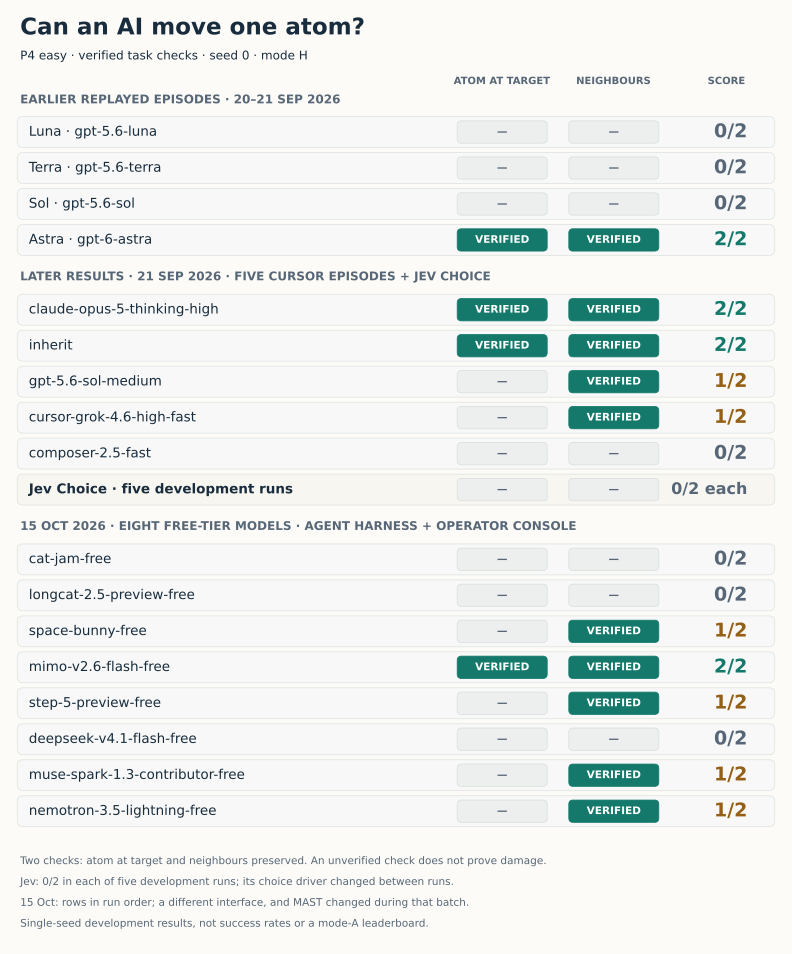
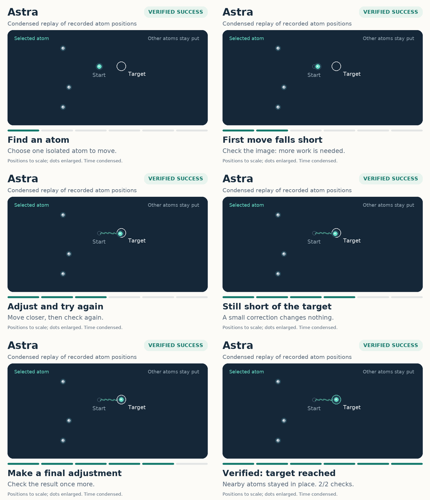
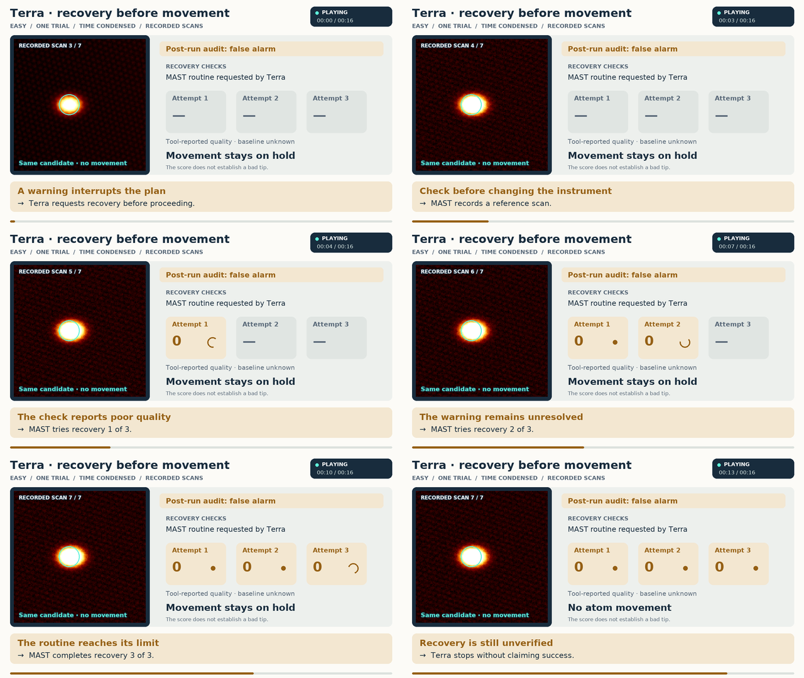

# Task 4: observe, act, check, and adjust

The task is to move one atom to a destination without disturbing its neighbours.
A command does not guarantee a successful move: the model must locate a candidate
in measured images, inspect what happened, and decide whether to change its
settings, try again, or stop. The homepage shows Astra's successful correction
loop and Terra's unsuccessful recovery from a diagnostic warning.



The score counts **two verified task checks**: the atom is at its destination,
and its neighbours are preserved. Verification includes the required measurement
evidence. An unverified check does not mean a neighbour was moved or damaged.
These single-seed development results do not estimate success rates or establish
a model ranking. Jev's row summarizes five runs with driver changes between them.
The [15 October 2026 group](#eight-free-tier-models-through-an-agent-harness-15-october-2026)
used a different interface, and MAST changed while it ran.

## Read the replays at your own pace

The homepage loops take about **24 seconds for Astra** and **16 seconds for
Terra**. A playing indicator and progress bar make their animation visible
immediately. The static storyboards let readers inspect the same decisions
without waiting for a loop. The scan panels are replay renderings of acquired
simulated scans, not pixel-identical copies of the agent's interface.
Explanatory annotations were added after the episode and were not guidance
supplied to the models.

### Astra: success requires repeated measurement



[Animation](astra-replay.gif) · [Final frame](astra-replay.png)

The animation begins after Astra has located an atom. A white/gold light shows
commanded tip motion; the teal trail shows the atom's recorded movement. A fixed
overview keeps all four atoms visible and marks the enlarged main view. Four
attempts alternate **manipulation and rescanning**, with pauses for adjustments
and final verification. The model chose its adjustments from scans, without seeing these
retrospective overlays.

| Stage | Saved scan | What the record establishes |
|---|---:|---|
| Search and inspect | 1–2 | An overview is followed by a closer scan of the chosen region. |
| First move falls short | 3 | The first attempt produces three recorded atom hops, far short of the requested destination. |
| Adjust and measure again | 4 | A slower move produces 16 hops and brings the atom close to the destination. |
| A correction changes nothing | 5 | The third attempt records no atom hops. Another scan establishes that outcome. |
| Adjust again and verify | 6 | The fourth attempt produces three hops. The final report and required evidence pass both task checks. |

There were **four move attempts, six saved scans, and about 54 simulated instrument
minutes**. The 22 recorded hops include backwards steps and revisits; they are not
22 distinct sites or a count of successful commands. Each manipulation attempt
was followed by a scan. The final atom position matches the target, and the three
relevant neighbours remain in place.

### Terra: recovery from an imperfect diagnostic



[Animation](terra-replay.gif) · [Final frame](terra-replay.png)

**The warning was a false alarm.** This episode exposes a limitation in MAST's
diagnostic tools; it is not evidence that the physical tip became unstable. The
reported image-quality scores also cannot be treated as the true tip quality.

| Stage | Saved scan | What the record establishes |
|---|---:|---|
| Search the surface | 1–2 | Terra acquires two views, runs feature detection, and exports measured data to locate a candidate. |
| Inspect a candidate | 3 | A closer view contains a real, isolated atom. Image analysis flags a possible tip change, and Terra reports the tip as unstable. |
| Assess before recovery | 4 | The conditioning tool acquires an assessment scan before applying a pulse. |
| Try three recovery steps | 5–7 | Each pulse is followed by a complete scan. The tool reports quality zero and never reaches its requested threshold. |
| Stop without a result | 7 | Terra ends the episode without moving an atom or submitting a completion report. |

The post-episode audit reproduced the warning near image row 119, but the
simulator's tip history contains no corresponding change. The first recorded
tip events are the later recovery pulses themselves. All three pulses have the
recorded outcome `no_effect`: the tip's single-apex shape remains unchanged,
although its length changes.

The model's final report confirms receiving a tip-change warning. The original
analysis reply is truncated before its details; row 119 comes from the later
diagnostic reproduction, not a retained original reading.

The retained recovery summary records three post-pulse scores of zero. Its
baseline score was not retained, so the replay shows that value as unknown.
The offline re-evaluation below is separate from those recorded tool results.

Offline evaluation of all seven saved scans also returned zero from the quality
metric: its sampled angular ring had fewer pixels than the required bins, which
caused an early zero return. That score does not establish a bad tip. The saved
tool replies are truncated, so additional evaluation errors during the episode
cannot be excluded. Terra attempted recovery, but neither it nor the support
tools resolved the misleading diagnosis.

## Earlier four replayed outcomes

| Model | Verified checks | Recorded atom hops | Saved scans | Recorded outcome |
|---|---:|---:|---:|---|
| Luna (`gpt-5.6-luna`) | 0/2 | 0 | 3 | Completed scans and detector retries, then reported an unconfirmed move from a location without an atom. |
| Terra (`gpt-5.6-terra`) | 0/2 | 0 | 7 | Attempted recovery after a false diagnostic warning; stopped without a result. |
| Sol (`gpt-5.6-sol`) | 0/2 | 0 | 1 | Located a plausible candidate but did not recover from parameter errors obscured by generic tool messages. |
| Astra (`gpt-6-astra`) | 2/2 | 22 | 6 | Repeated measurement and adjustment; both checks independently verified. |

Luna's detector eventually returned 218 heuristic candidates, but these did not
establish a valid atom at its chosen start. Its move tool returned an unconfirmed
result; the model nevertheless submitted both claims. This is a localization
and verification failure, with imperfect tool feedback also relevant. Sol's
rejected calls contained actual parameter errors; its failure is not evidence
that valid commands were rejected. Neither Terra nor Sol claimed completion.

## Earlier trial conditions and provenance

Recorded **20–21 September 2026 (UTC)**. These are one-seed development trials,
not a published mode-A leaderboard. **High difficulty was not tested in these
episodes.** The recorded experimental build is identified by its source
fingerprints in [results.json](results.json).

| Setting | Recorded value |
|---|---|
| Scenario | `P4_atom_positioning_cu111` |
| Difficulty / seed | `easy` / `0` |
| Driver | External model through the mode-H interface |
| MAST | Enabled; recorded support source held fixed |
| Model contexts | Fresh; no historical solutions or parent strategy feedback |
| Trials | Serial, one per model |
| Instrument budget | 5,400 simulated seconds; 200,000 controller commands |
| External-agent limits | 80 actions or 20 wall-clock minutes |

The easy profile begins with a sharp tip, disables linear drift and creep, and
scales electronic noise amplitude to 0.25. Stochastic manipulation, lattice
constraints, finite capture range and differences between atoms remain active.
The images still have measurement structure and noise. **Changes of view between
scans are commanded reframing or zooming, not evidence of drift.** These replays
do not demonstrate recovery from a poor starting tip or a drifting sample.

Observation limits were procedural, not operating-system isolation. Model
thinking paused the instrument clock. The instrument time quoted above is not
model response latency, animation duration, or a model speed comparison.

| Model | Run ID |
|---|---|
| Luna | `20260920T151024.658Z` |
| Terra | `20260920T153441.078Z` |
| Sol | `20260920T154740.074Z` |
| Astra | `20260921T065308.969Z` |

Recorded source fingerprints:

- Simulator and benchmark: `164f01def8cb16886d6110cb55d34aa8edaa28789d8131ecc313b4ece02f1ccc`.
- MAST support: `12e93759433aea0b93a46faa24134dd002ce4ad1848e4f30e70062f9ba01c8bc`.

The MAST fingerprint covers the source subtrees recorded by the harness, not
the entire environment. The aggregate data also includes hashes of the original
episode records.

## How these replays are made

These are **condensed, annotated replays of recorded simulated measurements**.
The scan panels use the PNG renderings extracted from the existing replays of
acquired scans, without adding noise or painting a different result. The derived
images are in [scans/](scans/); image provenance and supporting event summaries
are in [replay-evidence.json](replay-evidence.json).

Astra uses a fixed crop in sample coordinates and a permanent overview of all
four atoms, with a rectangle marking the main view. Recorded scans 2–6 replace
the backgrounds only at completed-scan checkpoints. Between scans, the image can
still show the atom at its previous measured position while the overlay advances:
that is a held measurement, not a second atom or a live camera image.

The two moving markers have different sources:

- **Teal atom:** the 22 logged hops in [replay-data.json](replay-data.json),
  including backwards steps and revisits. Atom positions are never interpolated.
- **White/gold tip light:** interpolation between 93 successful command
  destinations in [tip-motion.json](tip-motion.json). These are command parameters,
  not position readbacks or a measured continuous tip path. Their approximate
  timestamps do not establish exact motion onset or synchronization with every
  atom hop; the source file records the timing reconstruction and its limits.

Astra's 24-second loop contains 480 frames at 20 frames per second. Each recorded
512-second verification scan occupies exactly one replay second, labelled
**512× fast-forward**. The first two manipulations are labelled **sped up / edited**;
the last two are **slow motion / detail**. Reading pauses and cuts are labelled,
and model thinking time is omitted. Terra retains 80 frames over 16 seconds with
a persistent **time compressed / cuts** label. These edited loops do not compare
model speed or reproduce a continuous experiment clock.

Paths, destination markers and neighbour circles are post-episode annotations
unavailable to the models. Playback pulses are display cues, not physical
vibration. Terra uses recorded scans and recovery events without an invented
atom trajectory. The positional file also retains older Luna data. Narration
and playback phases are recorded in the schema-3 Astra
[replay-scenes.json](replay-scenes.json) and [terra-scenes.json](terra-scenes.json).
Rounded image estimates remain separate from the simulator's hop coordinates.

The original ledgers remain unchanged. Raw acquisition files, full private
ledgers, machine paths, and credentials are not published in these assets.
The merged scorecard draws its earlier four rows from [results.json](results.json),
the next five from [cursor-results.json](cursor-results.json), Jev's summary
from [jev-results.json](jev-results.json), and the last eight from
[opencode-results.json](opencode-results.json). The figure combines published
aggregates; it does not change experimental conditions or episode records.

Regenerate the merged scorecard and replays with Python, Matplotlib and Pillow installed:

```bash
python docs/assets/p4-homepage/generate_results.py
python docs/assets/p4-homepage/generate_replays.py
```

The generators render existing evidence; they do not rerun the experiments.
`generate_replays.py` also calls `render_terra.py` for the recovery comparison.
To re-extract the scan PNGs and provenance from the original standalone replay
files, run `export_evidence.py --replay-dir <replay-directory>` from this folder.
Regenerating the figures themselves uses the included images and JSON only.
The root README uses relative image links and requires no live instrument
connection or embedded script.

## Later five-model comparison and Jev Choice

The merged homepage chart adds five **21 September 2026 (UTC)** P4 easy,
seed-0, mode-H development runs made in a Cursor session. This is a separate
set of episodes from the four replayed above. Their [aggregate results](cursor-results.json)
retain the selected run IDs, verified-claim flags, hashes of the private
`episode.json` files and recorded MAST/STM-Bench Git HEAD values. The
private ledgers and raw acquisition files are not part of this repository.

| Model ID | Run ID | Verified checks |
|---|---|---:|
| `claude-opus-5-thinking-high` | `20260921T122033.249Z` | 2/2 |
| `inherit` | `20260921T125317.144Z` | 2/2 |
| `gpt-5.6-sol-medium` | `20260921T123906.982Z` | 1/2 |
| `cursor-grok-4.6-high-fast` | `20260921T124053.618Z` | 1/2 |
| `composer-2.5-fast` | `20260921T123918.571Z` | 0/2 |

These runs used the same scenario contents and rig settings after accounting
for the absolute rig path in each local profile: a sharp starting tip, no
linear drift or creep, and electronic noise scaled to 0.25. All five ledgers
record the same MAST and STM-Bench Git HEAD values. The `inherit` directory
also contains an earlier 2/2 ledger; the table selects the later run named by
its summary. A 1/2 for Sol or Grok means the neighbour-preservation check
passed while target-site value verification failed. The scores describe
verified claims for one seed, not model success rates or a mode-A ranking.
`inherit` is the identifier recorded by the external driver; the ledger does
not resolve it to an underlying provider model. Git HEAD does not include
uncommitted changes, so matching values do not prove that the executed code
was identical across episodes or capture the entire private MAST environment.

**Jev Choice is a separate experimental mode-H driver.** Its five P4 easy,
seed-0 development runs on 21 September 2026 each scored **0/2**. Their
[aggregate record](jev-results.json) includes ledger hashes. The run IDs
are `20260921T080649.097Z`, `20260921T082137.633Z`,
`20260921T082629.363Z`, `20260921T083017.173Z` and
`20260921T083739.917Z`. The driver offers finite choices derived from scans;
its tracking and retry limits changed between runs. The chart's Jev row
summarizes these development iterations, not five independent samples.

## Eight free-tier models through an agent harness (15 October 2026)

The chart's third group adds eight **15 October 2026 (UTC)** P4 easy, seed-0,
mode-H development runs, one per model, run serially with a fresh server and
episode each. Each model ran as a fresh subagent of the opencode agent harness,
through the opencode provider's free tier, and operated the instrument only
through a local command-line console over the mode-H HTTP interface. The
[aggregate results](opencode-results.json) retain the run IDs, verified-claim
flags, every manipulation request with its recorded hops, hashes of the private
`episode.json` files and the recorded Git HEAD values. The private ledgers,
agent transcripts and raw acquisition files are not part of this repository.

| Model ID | Run ID | Verified checks | Recorded outcome |
|---|---|---:|---|
| `opencode/cat-jam-free` | `20261015T105434.966Z` | 0/2 | Seven scans and two default-setting moves without a recorded hop; the instrument-time budget ran out before a report. |
| `opencode/longcat-2.5-preview-free` | `20261015T110308.026Z` | 0/2 | One default-setting move carried an atom 1.59 nm in six hops; the 20-minute wall-clock limit ended the episode before a report. |
| `opencode/space-bunny-free` | `20261015T113124.669Z` | 1/2 | Two moves at the default current carried two different atoms 0.68 and 0.43 nm; later moves at 20 and 1 nA recorded no hop. The reported atom was 3.37 nm from its goal. |
| `opencode/mimo-v2.6-flash-free` | `20261015T114620.142Z` | 2/2 | The default setting gave one 0.43 nm hop; after a rejected 100 nA request, 99 nA at 0.2 nm/s carried the atom 19 hops onto its goal site. |
| `opencode/step-5-preview-free` | `20261015T120907.524Z` | 1/2 | The default setting and then 85 nA carried the atom 2.70 nm in twelve hops; it was reported 1.35 nm short, shortly before the wall-clock limit. |
| `opencode/deepseek-v4.1-flash-free` | `20261015T123244.466Z` | 0/2 | Moves at the default setting, 1 nA and 95 nA, and a rejected 100 nA request, carried the atom 1.59 nm in seven hops; the instrument-time budget ran out before a report. |
| `opencode/muse-spark-1.3-contributor-free` | `20261015T124920.767Z` | 1/2 | No hop at the default setting or at 30 nA; 80 nA at 0.3 nm/s carried the atom 3.86 nm in 15 hops, one lattice site (0.255 nm) short of its goal. |
| `opencode/nemotron-3.5-lightning-free` | `20261015T130115.517Z` | 1/2 | One default-setting move carried the atom 2.70 nm in ten hops; it was reported 1.35 nm short of its goal. |

Rows are in run order. A 1/2 means the neighbour-preservation check passed
while the target-site check failed. The three 0/2 runs reported no position,
so the judge had no moved atom to which it could bind the neighbour check;
this does not show that a neighbour moved. Hop counts, displacements and
distances to the goal come from the simulator's post-episode records, which
the models did not see during their runs.

### What the records show

- **The manipulation setting decided how far an atom went.** Every run's first
  move used the tool's default setting, which the hop records give as 175 kΩ at
  0.5 nm/s (57 nA at 10 mV). These first moves carried an atom between zero and
  2.70 nm, never the full 4 nm. Requests at 30, 20 and 1 nA, which raise the
  junction resistance, recorded no hop. The two runs that moved an atom more
  than 3.8 nm used 80–99 nA (125–101 kΩ) at 0.2–0.3 nm/s; only one of them
  ended on the goal site.
- **Every executed move returned the same reply.** `MoveAtomTo` answered each
  executed call with the same text, that the move ran without rescan
  confirmation, including calls that recorded no hop and the call that reached
  the goal. Only a later scan could show the outcome.
- **A 100 nA request was rejected as above its own maximum.** The parameter
  check converted 100 nA to `1.0000000000000001e-07` A and refused it as above
  the 100 nA limit. Both models that tried it continued at 99 or 95 nA. The
  remaining rejection was a retry count above the allowed three.
- **Budgets ended four runs.** Two runs exhausted the 5,400 s instrument-time
  budget (5,594 s and 5,404 s used), and two reached the 20-minute wall-clock
  limit. A 384-pixel frame took roughly 800 s of instrument time; a move with
  its verification scan took about 650 s.
- **The reported positions were measured.** The five reports were
  0.001–0.032 nm from the moved atom's actual position, and none gave the goal
  coordinates in place of a measurement. The 1/2 results failed on where the
  atom was, not on locating it.

### Conditions and limitations

| Setting | Recorded value |
|---|---|
| Scenario / difficulty / seed | `P4_atom_positioning_cu111` / easy / 0 |
| Driver | One fresh opencode subagent per model; serial; one episode each |
| Interface | Console over the mode-H HTTP API: the standard mode-H tools, a heuristic blob detector, a bounded numeric sandbox and PNG rendering |
| Limits | 80 instrument actions, 20 wall-clock minutes, 5,400 simulated seconds, 200,000 controller commands |
| Simulator and judge | September 2026 versions from private checkout `1abed1d` (see below) |
| MAST | Maintainer's full environment, not held fixed (see below) |

The easy profile was generated outside the scenario directory and was identical
in all eight runs apart from its absolute rig path: a sharp starting tip, no
linear drift or creep, and electronic noise scaled to 0.25, as in the September
runs above. The prompt gave each model the scenario task verbatim, the console
commands, the limits and procedural rules: use only the console; do not read
the episode ledger, repository source, scenario files, other trials or the
internet; report only what was measured. It suggested no manipulation settings.
It did state that a move reply would describe the result and residual, which
the instrument's reply did not do.

**The batch ran on the September 2026 simulator and judge.** The recorded
STM-Bench HEAD `1abed1d` is a private development checkout. Its `stmsim/`,
`stmbench/` and `tests/` trees match public commit `0923f40` apart from the
unpublished easy-profile and Jev driver modules and the electronic-noise scale
in `stmsim/physics/world.py`. That judge matches a report to the moved atom
within 0.6 nm of it and passes the target check only when that atom sits on the
goal lattice site; the follow-up frame needs a field of view of at least 6 nm
at no more than 0.1 nm/px. The scenario file's `abs_nm: 0.16` was not applied.
P4's physics, rules and evidence checks on `main` changed on 12–14 October
2026. These runs predate those changes, their verdicts were not recomputed
under the new rules, and they do not describe the current release.

**MAST was not held fixed.** The maintainer's MAST checkout received eleven
commits while the batch ran, including changes to its connection, runtime,
diagnostics and monitoring modules. The ledgers record five different MAST Git
HEAD values, and the batch's condition record captured only the HEAD at its
start. Each recorded value is the HEAD when that ledger was written, not
necessarily the code that the run's server had imported. The effect of these
changes on the episodes was not assessed.

**Observation limits were procedural, not operating-system isolation.** A
post-run audit of the eight agent transcripts found no read of an episode
ledger, the generated profile, the scenario file or simulator source during any
episode. The cat-jam run read part of the console script and then called it
with the same interpreter instead of through its wrapper. After its episode had
ended, the nemotron run listed its ledger directories, displayed the benchmark
CLI's help text and attempted further instrument commands, which the server
refused. The audit covers the tool calls the harness recorded; it does not prove
that no other information reached a model.

Two scripted console checks preceded the batch and used only console
observations: `20261015T104435.522Z` scored 0/2 with the default manipulation
setting and `20261015T105101.080Z` scored 1/2 at 90 nA and 0.5 nm/s. They tested
the console and server, not a model, and are not chart rows.

These are single-seed development observations through one harness and
interface, not success rates, a model ranking or a mode-A leaderboard. The
model identifiers are those recorded by the harness and provider; they do not
establish an underlying model version. The limits match those of the September
runs, but the interface and harness differ, so these rows are not comparable
cell for cell with the groups above.
